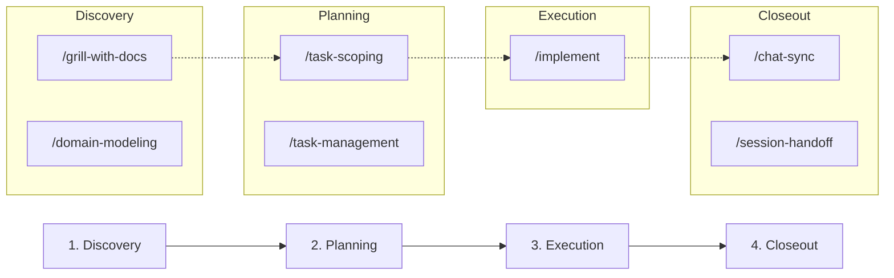
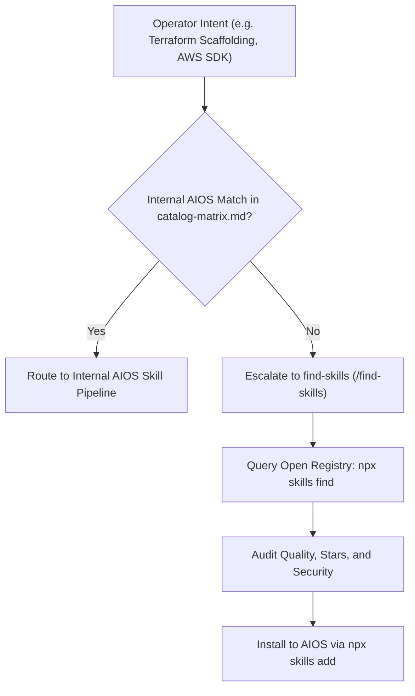

# Flow Taxonomies: Multi-Skill Execution Pipelines

This document formalizes standardized multi-skill pipeline recipes across AIOS. Individual skills are building blocks; flows define how they chain together to complete complex, multi-stage operational objectives.

---

## 1. The Core Builder Pipeline (Idea -> Ship)

The primary pipeline for standard feature requests and workspace additions.

### Execution Steps:

1. **Discovery & Architecture:** Execute [`grill-with-docs`](../../grill-with-docs/SKILL.md). Conduct interactive interrogation rounds, record hard architectural decisions under `decisions/` as ADRs, and synchronize domain terms into [`CONTEXT.md`](../../../../CONTEXT.md) via [`domain-modeling`](../../domain-modeling/SKILL.md).
2. **Task Decomposition:** Execute [`task-scoping`](../../task-scoping/SKILL.md). Decompose the brief into vertical slices declaring blocking dependencies. Record in [`tasks/`](../../../../tasks/tasks-index.md) via [`task-management`](../../task-management/SKILL.md).
3. **Test-First Implementation:** Execute [`implement`](../../implement/SKILL.md). Build each vertical slice using disciplined Red-Green-Refactor cycles. Verify with tests and atomic git commits.
4. **Closeout & Sync:** Execute [`chat-sync`](../../chat-sync/SKILL.md) to harvest durable memories and update canon logs before session conclusion.

---

## 2. The Greenfield System Pipeline (High Fog of War)

For complex, ambiguous, or high-uncertainty greenfield builds where domain boundaries are unknown.

### Execution Steps:

1. **Multi-Gate Discipline:** Launch [`fable-mode`](../../fable-mode/SKILL.md). Enforce multi-gate checkpoints, deep boundary probing, and prototype spikes.
2. **External Knowledge Gathering:** If requirements rely on third-party documentation, dispatch [`research`](../../research/SKILL.md) to extract cited primary-source findings.
3. **Stakeholder Alignment:** If external clarity from collaborators or clients is needed, invoke [`to-questionnaire`](../../to-questionnaire/SKILL.md) to produce a standalone asynchronous questionnaire.
4. **Structured Handoff:** Once the fog clears and specs freeze, hand off via [`references/phase-boundaries.md`](phase-boundaries.md) to [`task-scoping`](../../task-scoping/SKILL.md) and [`implement`](../../implement/SKILL.md).

---

## 3. The Architecture Modernization & Refactoring Pipeline

For codebase health, god-node decomposition, circular dependency cleanup, and token efficiency audits.

### Execution Steps:

1. **AST & Knowledge Graph Analysis:** Run [`graphify`](../../graphify/SKILL.md) to construct the AST knowledge graph, detect god nodes, and identify clustered modules.
2. **Structural Debt Audit:** Execute [`improve-codebase-architecture`](../../improve-codebase-architecture/SKILL.md) to evaluate module boundaries and generate refactoring targets.
3. **Token Budget Assessment:** Execute [`token-optimizer`](../../token-optimizer/SKILL.md) to eliminate instruction bloat across preloaded instruction files.
4. **Refactoring Execution:** Execute [`implement`](../../implement/SKILL.md) to perform structural refactors test-first.
5. **Formatting & Punctuation Sweep:** Run [`de-emdash`](../../de-emdash/SKILL.md) to enforce punctuation standards.

---

## 4. The Deep System Diagnostic & Tuning Pipeline

For PC stability, crashes, driver latency, peripheral calibration, and OS debloating.

### Execution Steps:

1. **Crash & Dump Forensics:** If an incident or blue screen occurred, execute [`pc-incident-forensics`](../../pc-incident-forensics/SKILL.md). Ingest memory dumps, Windows Event Viewer XML logs, and reliability history before forming hypotheses.
2. **System Health & Hardware Triage:** Execute [`pc-systems-engineer`](../../pc-systems-engineer/SKILL.md) to inspect drivers, storage health, network stack, and Windows thermal/power profiles.
3. **Gaming & Peripheral Tuning:** For framerate, latency, and input responsiveness, chain [`game-optimization`](../../game-optimization/SKILL.md), [`peripherals-display-tuner`](../../peripherals-display-tuner/SKILL.md), and [`remote-streaming-sync`](../../remote-streaming-sync/SKILL.md).
4. **OS Debloat & Service Optimization:** Execute [`windows-debloat`](../../windows-debloat/SKILL.md) to inventory packages, prune startup bloat, and streamline services.

---

## 5. The External Package Fallback Bridge (`find-skills`)

When an operator intent or technical capability is requested that does not exist among the 91 internal AIOS skills:

### Fallback Policy:

- Never guess or force an internal skill if the domain is unsupported.
- Seamlessly transition to [`find-skills`](../../find-skills/SKILL.md).
- Search `skills.sh` or the Skills CLI (`npx skills find <query>`), audit package reputation, and offer direct installation to the operator.

---

## Related Documents

- [`catalog-matrix.md`](catalog-matrix.md): Exhaustive skill classification matrix.
- [`phase-boundaries.md`](phase-boundaries.md): 5-option context transition decision tree.
