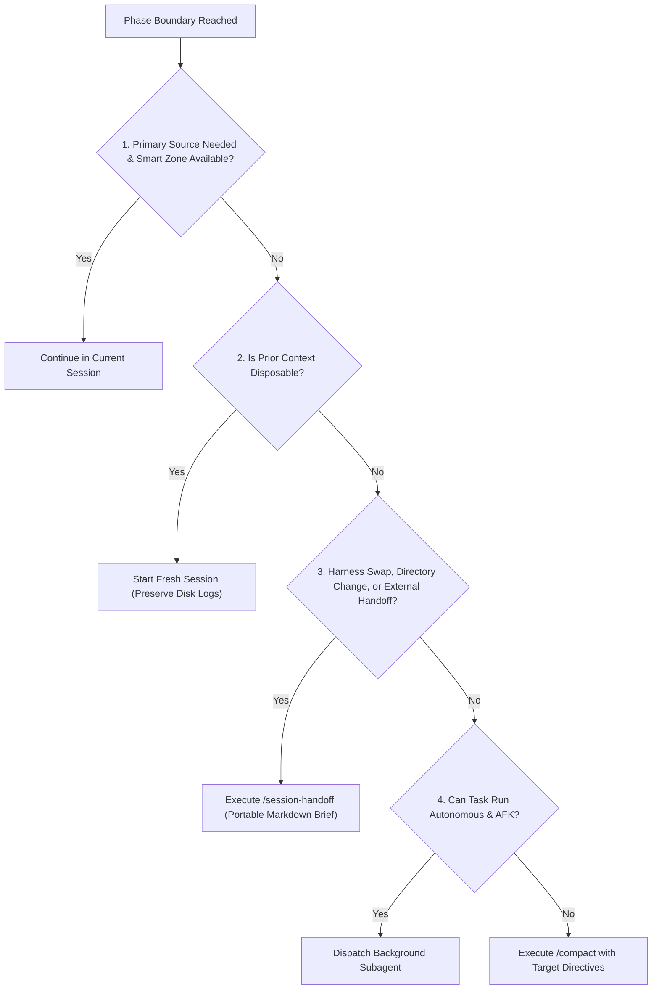

# Phase Boundaries

A **phase** is a discrete unit of work within a development lifecycle: discovery/grilling, task decomposition, implementation, or system verification.

A **phase boundary** is the transition point between two phases. It is the only point where context management decisions should be evaluated. Mid-phase, maintain continuity or dispatch background subagents for non-blocking sub-tasks.

---

## The Five Boundary Actions

| Action                 | Mechanism                | Tradeoff                                                             | Best Used When                                                                    |
| ---------------------- | ------------------------ | -------------------------------------------------------------------- | --------------------------------------------------------------------------------- |
| **Continue**           | Remain in active session | Zero context loss; consumes smart zone (below ~400k tokens)          | Next phase requires verbatim reasoning as a primary source                        |
| **Fresh Session**      | Open new chat window     | Resets window to 100% capacity; preserves disk transcripts           | Current context is disposable; task checklist already committed                   |
| **`/session-handoff`** | Emit markdown briefing   | Creates portable transfer artifact across directories/harnesses      | Switching engines (Claude <-> Antigravity), directories, or delegating            |
| **Subagent**           | Launch isolated agent    | Zero primary session pollution; executes in background               | Task is self-contained and execution is autonomous (e.g. diff review, test sweep) |
| **`/compact`**         | Context summarization    | Compresses window; turns primary source into lossy secondary summary | Must stay in same session/directory but smart zone limit reached                  |

---

## The Precedence Decision Tree

Evaluate top-to-bottom at every phase boundary. The first affirmative condition dictates the action:

### Detailed Evaluation Steps:

1. **Can you continue in this session?**
   - _Test:_ Does the next phase require this session's unbroken dialogue as a **primary source**, and is the current token footprint well within the **smart zone** (below ~400k tokens, the warning point the user gets in Claude Code)?
   - _Verdict:_ If yes, **Continue**. Grilling -> implementation is the canonical yes, preserving exact technical rationale without lossy compression.

2. **Is prior context disposable?**
   - _Test:_ Are earlier exploration logs, brainstorming, and dead ends irrelevant to the next step, with key outputs already written to disk (e.g. [`BUILD-PLAN.md`](../../../../BUILD-PLAN.md), task markdown)?
   - _Verdict:_ If yes, **Open a Fresh Session**. Never run `/clear` (which wipes chat records permanently). A fresh session starts with a clean window while keeping audit trails intact.

3. **Do you need a portable handoff?**
   - _Test:_ Are you swapping engines (Claude Code <-> Antigravity), switching to a different working directory or peer repo, or handing off work to a collaborator?
   - _Verdict:_ If yes, execute **[`/session-handoff`](../../session-handoff/SKILL.md)**. Handoff creates a standalone, portable briefing document. If no boundary transition is occurring, `/session-handoff` is unneeded.

4. **Can the task execute autonomously?**
   - _Test:_ Is the task tightly scoped, deterministic, and runnable without interactive human steering?
   - _Verdict:_ If yes, dispatch a **Subagent** (e.g. background test suite execution, research parsing, code review).

5. **Otherwise: `/compact`.**
   - _Test:_ Context is relevant, you are remaining in the same harness and directory, and token consumption approaches the smart zone limit.
   - _Verdict:_ Execute **`/compact`** with an explicit focus instruction (e.g. `/compact retain architectural constraints and active task list`).

---

## Primary vs. Secondary Source Tradeoff

| Source Type                                           | Source Fidelity                | Token Noise                | Operational Agility                 |
| ----------------------------------------------------- | ------------------------------ | -------------------------- | ----------------------------------- |
| **Primary Source (Continue)**                         | Full (100% verbatim)           | High (accumulates history) | Constrained by remaining smart zone |
| **Secondary Source (`/compact`, `/session-handoff`)** | Lossy (condensed abstractions) | Low (minimal footprint)    | Maximum context headroom            |

---

## Related Documents

- [`catalog-matrix.md`](catalog-matrix.md): Exhaustive skill classification and routing table.
- [`flow-taxonomies.md`](flow-taxonomies.md): Standardized end-to-end multi-skill execution pipelines.
- [`session-handoff`](../../session-handoff/SKILL.md): Standalone portable briefing generator.
