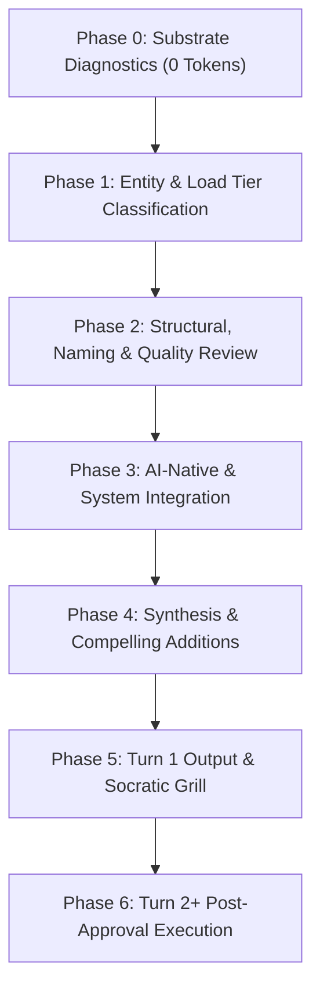

# Component Audit, Optimization & Architecture

The singular, authoritative skill to audit, optimize, and elevate any component across the Leonidas AI Operating System and related assets. It systematically analyzes target assets, verifies naming conventions and drive taxonomy, enforces core quality standards, evaluates memory and tool stack integrations, identifies automation opportunities, and proposes compounding architectural upgrades while strictly preserving healthy components.

---

## 1. Initial Identification Protocol

Before performing any analysis, the auditor determines the target asset's nature and boundary:

### A. Determine Entity Type

Explicitly identify the asset category:

1. **Single File:** Markdown documentation, configuration file, or script.
2. **Folder / Directory:** Subsystem tree, domain folder, or project directory.
3. **Both (Subsystem):** A parent directory and its primary constituent files audited as a unified unit.
4. **Artifact:** Ephemeral or generated output (e.g. brain transcripts, dashboards, exports).
5. **Specialized System Entity:**
   - **Agent Skill:** `.agents/skills/<name>/SKILL.md`
   - **System Mode:** `modes/<num>-<slug>.md` or `modes/router.md`
   - **Architectural Decision (ADR):** `decisions/<0000>-<slug>.md`
   - **System Prompt / Template:** `prompts/*.md` or `templates/*.md`
   - **Automation Script:** `scripts/*.ps1` or `scripts/*.py`
   - **Durable Memory / Domain Store:** `memory/*.md`, `domains/*`, `ideal-state/*`
   - **Operational Task:** `tasks/*.md`
6. **External / Related Asset:** Workspaces, external repositories, or tools residing on the another drive outside AIOS root.

For detailed analysis vectors per entity type, consult [`references/entity-analysis-matrix.md`](references/entity-analysis-matrix.md).

### B. Scope Definition

- **Core Scope:** Leonidas AIOS files, folders, and structural components.
- **Extended Scope:** The skill is fully authorized to inspect and audit assets outside the AIOS repository (e.g. D: drive workspaces, tool configs) when required by the optimization task.
- **Isolation Barrier:** Modifying files outside the current repository or touching peer domains (`the peer AIOS\`) strictly requires explicit operator confirmation per [ADR-0008](../../../decisions/0008-mode-3-is-a-cross-repo-read-overlay.md).

### C. Ambiguity Resolution Protocol

- **Ambiguous Request:** If the target path or entity type is unclear, pause and prompt the operator with candidate targets and quick-selection choices.
- **Unambiguous Context:** If the operator has provided the path, file name, or context, proceed directly to analysis without redundant questioning.

---

## 2. Core Audit and Optimization Workflow

Every audit executes across seven disciplined phases. No phase may be skipped:



### Phase 0: Deterministic Substrate Ingest (0 LLM Tokens)

Run fast deterministic diagnostics before parsing files with LLM tokens:

1. Run the component audit script:
   `pwsh -NoProfile -File .agents/skills/component-audit/scripts/Audit-Component.ps1 -Target "<path>"`
   - Query longitudinal stability: `-History` (reports 30-day stability score and defect history from `logs/audit-telemetry.jsonl`).
   - Validate staged Git changeset: `-Staged` (audits only staged files in <150ms for pre-commit hooks).
   - Side-by-side reading brief: `-Teardown` (emits structured teardown for VS Code split editor views).
2. Ingest mechanical metrics:
   - Unicode U+2014 em dash count
   - Broken markdown links and unresolvable relative targets
   - Frontmatter schema validity and `scope: personal | structural` tag presence
   - PowerShell and Python AST syntax validation
   - Word count and estimated token footprint
   - Inbound repository reference count via ripgrep (`rg`)

### Phase 1: Entity Classification & Load Tier Budgeting

Classify the asset into its operational context tier:

- **Tier 0 (Preloaded / Always-Loaded):** Loaded every session (`AGENTS.md`, `CLAUDE.md`, `GEMINI.md`, `memory/core.md`, `memory/soul.md`, `modes/router.md`). Must remain ultra-dense (<120 lines / <2,500 words) and strictly respect Antigravity's 24,000-byte rule file truncation cliff.
- **Tier 1 (On-Demand / Task Domain):** Loaded when relevant (`skills/`, `modes/`, `prompts/`, domain stores). Must use progressive disclosure.
- **Tier 2 (Structural Canon):** Authoritative references (`standards/`, `decisions/`, `templates/`, `wiki/`).
- **Tier 3 (Ephemeral / Operational):** Work records (`tasks/`, `capture/`, `audits/`, `logs/`).

### Phase 2: Structural, Naming & Quality Standards Review

Inspect the target against core AIOS quality standards (detailed in [`references/quality-rubric.md`](references/quality-rubric.md)):

1. **Naming Standards:** Verify against [`standards/naming-standard.md`](../../../standards/naming-standard.md):
   - Non-root markdown files and directories: lowercase kebab-case (`^[a-z0-9-]+$`).
   - Root instruction files: ALL-CAPS hyphenated (`AGENTS.md`, `CONTEXT.md`).
   - PowerShell scripts: PascalCase approved verbs (`Verb-Noun.ps1`).
   - Python scripts: lowercase kebab-case (`track-skill.py`).
   - Temporal files: ISO date prefixes (`YYYY-MM-DD-slug.md`).
   - Reserved collision blacklist: flag any lowercase tool files named `claude.md`, `agents.md`, or `gemini.md`.
2. **Location Optimization:** Verify directory placement against [`standards/drive-taxonomy.md`](../../../standards/drive-taxonomy.md). If misplaced (e.g. scratch files inside knowledge directories, loose files at repository root), formulate a relocation recommendation.
3. **Single Authoritative Write Path (SAWP):** Verify that the component represents the single authoritative source of truth for its facts. Identify duplicate records in parallel folders.
4. **Zero Em-Dash Standard (ADR-0012):** Zero Unicode U+2014 characters.
5. **Mandatory Relative File Links (Rule 7):** Ensure all in-repo markdown links are relative (`./path/file.md`).
6. **Frontmatter & Scope Tag (ADR-0013):** Indexed files must carry `scope: personal` or `scope: structural` and double-quoted strings.
7. **The 4 Context Failure Modes:** Audit for Poisoning (stale data), Bloat (unneeded padding), Confusion (missing routing), and Clash (contradictions).

### Phase 3: AI-Native Usability & System Integration

Evaluate how the asset integrates with the AIOS operating environment:

1. **Skill Applicability Analysis:** Check if complementary skills should be invoked:
   - [`grill-me`](../grill-me/SKILL.md) / [`grill-with-docs`](../grill-with-docs/SKILL.md): Interrogating architectural choices.
   - [`fable-mode`](../fable-mode/SKILL.md): Rigorous 5-gate evidence verification.
   - [`de-emdash`](../de-emdash/SKILL.md): Automated stripping of U+2014 characters.
   - [`context-engineering`](../context-engineering/SKILL.md): 5-tier context budgeting.
   - [`automation-architect`](../automation-architect/SKILL.md): Routing workflows across 6 automation tiers.
   - [`improve-codebase-architecture`](../improve-codebase-architecture/SKILL.md): Modular refactoring and Mermaid dependency trees.
   - [`system-prompt-authoring`](../system-prompt-authoring/SKILL.md) / [`skill-creator`](../skill-creator/SKILL.md): Prompt and skill structure optimization.
   - [`token-optimizer`](../token-optimizer/SKILL.md): Text compression and density tuning.
   - [`ask-leonidas`](../ask-leonidas/SKILL.md): Skill routing and phase boundary management.
2. **Memory Integration:**
   - _mem0 Integration:_ Search mem0 (`user_id=<tenant-scope>`) for existing durable facts. Determine if durable facts inside the component should be indexed via [`scripts/Sync-Mem0Index.ps1`](../../../scripts/Sync-Mem0Index.ps1).
   - _Observed Stores:_ Capture operational friction into `memory/observed/antifragile.md` or behavioral patterns into `memory/observed/patterns.md`.
   - _Store Cascade:_ Ensure facts follow the Store Cascade: `memory/` -> `tasks/` -> `projects/` -> `CONTEXT.md` -> `wiki/` -> `logs/` -> `decisions/`.
3. **Standardization & Gap Analysis:**
   - Determine if schema templates from `templates/` or governing standards from `standards/` apply.
   - Identify missing system rules or instructions and propose closing those gaps.
4. **Token Efficiency & Progressive Disclosure:**
   - Prune conversational filler, pleasantries, and speculative abstractions.
   - Factor heavy lookup tables (>30 lines) into disclosed modules under `references/`.
5. **Agent Usability Optimization:**
   - Structure with front-loaded active verbs, scannable headings, bold category leads, and deterministic completion criteria.
6. **Automation Potential (6 Tiers):**
   - Identify candidate automations across Tier 1 (PowerShell/Python), Tier 2 (Task Scheduler), Tier 3 (Agent Loops), Tier 4 (n8n), Tier 5 (MCP), and Tier 6 (Git Pre-Commit Hooks).
7. **Tool Stack Integration:**
   - Evaluate integration opportunities with Hermes, VS Code, Claude Code, Google Antigravity, Vivaldi browser, Obsidian, ActivityWatch, n8n, and Git.

### Phase 4: Synthesis, Defect Classification & Compelling Additions

1. **3-Bucket Defect Ledger:**
   - **Bucket 1: Active Defects / Regressions:** Breaking bugs, dead links, em dash violations, or naming collisions requiring remediation.
   - **Bucket 2: Known In-Flight / Roadmap:** Items already tracked in [`TASKS.md`](../../../TASKS.md) or [`BUILD-PLAN.md`](../../../BUILD-PLAN.md).
   - **Bucket 3: Certified Clean:** Healthy areas with zero active defects.
2. **Quality Preservation Principle ("If it's good, leave it good"):**
   - If an asset satisfies all quality standards and functions effectively, do NOT invent cosmetic improvements. State `VERDICT: CERTIFIED CLEAN` and leave it intact.
3. **Compelling Additions Curation:**
   - Formulate 1 to 3 non-obvious, high-leverage compounding additions detailing the exact technical mechanism, systemic leverage, and operational ROI (guided by [`references/compelling-additions-guide.md`](references/compelling-additions-guide.md)).

---

## 3. Turn 1 Output Contract & Execution Barrier

In Turn 1, the auditor evaluates silently and outputs ONLY these four sections:

### 1. Executive TL;DR & Component Health Scorecard

A compact markdown table summarizing findings:

| Target Component | Entity Type | Tier             | Words / Tokens       | Naming & Path        | SAWP / Duplication | Frontmatter & Links | Automation Potential |
| ---------------- | ----------- | ---------------- | -------------------- | -------------------- | ------------------ | ------------------- | -------------------- |
| `[path]`         | `[Type]`    | `[Tier 0/1/2/3]` | `[N words / ~N tok]` | `[PASS / CANDIDATE]` | `[PASS / ISSUE]`   | `[PASS / N WARNS]`  | `[Tier 1-6 / None]`  |

### 2. Actionable Change Manifest

- **Proposed Rename / Relocation:** Target path -> New path (with rationale) or None.
- **Deletions / Stale Cleanup:** Deprecated sections, dead references, or pruned clutter or None.
- **New Standards / Templates / Scripts:** Proposed additions to `standards/`, `templates/`, or `scripts/` or None.
- **Downstream Ripples:** External files requiring link updates or None.

### 3. Non-Obvious Compelling Additions

Top 1 to 3 high-leverage additions detailing mechanism, leverage, and ROI.

### 4. Socratic Grill Interview (Round 1)

Present 1 to 3 numbered architectural questions strictly adhering to the Option Quality Ceiling Standard:

```markdown
❓ **Q1** - **<Question Title>**: <Question body detailing tradeoffs>

- **Option A:** <Description> (Wins when: ...)
- **Option B:** <Description> (Wins when: ...)
  ➡️ **Recommended:** <Option X> because <single deciding factor>. What flips it: <condition>.
```

⚠️ **EXECUTION BARRIER (DO NOT WRITE TO DISK YET):**
In Turn 1, the agent is STRICTLY FORBIDDEN from modifying files, renaming directories, or writing to disk. STOP and wait for operator responses.

---

## 4. Turn 2+ Post-Approval Execution

Upon receiving operator confirmation or selections:

1. **Process Decisions & Harvest Failure Modes:**
   - Lock approved options into system context. Author ADRs in `decisions/` if structural decisions were made.
   - If an operational defect or failure mode was resolved, harvest into durable memory via:
     `pwsh -NoProfile -File .agents/skills/component-audit/scripts/Log-AuditFailureMode.ps1 -Component "<path>" -Title "<Title>" -FailureMode <Mode> -Failure "<Failure>" -RootCause "<Cause>" -PermanentRule "<Rule>"`
2. **Safe Relocations & Renames (Atomic Link Refactoring):**
   - If paths changed, execute atomic moves and inbound link rewrites in one shot via:
     `pwsh -NoProfile -File .agents/skills/component-audit/scripts/Move-AiosComponent.ps1 -Source "<old-path>" -Destination "<new-path>" -Execute`
3. **Direct Disk Mutation:** Apply approved edits directly to target files, create extracted `references/` modules, and scaffold deterministic scripts.
4. **Substrate & Index Refresh:**
   - Run `pwsh -File scripts/Build-Index.ps1` to rebuild affected folder indexes.
   - Run `pwsh -NoProfile -File scripts/Audit-Substrate.ps1` to verify zero substrate defects.
5. **Git Commit:** Commit changes with a descriptive conventional commit per [ADR-0010](../../../decisions/0010-git-history-replaces-the-master-log.md).

---

## 5. Completion Criteria ("Done When")

An audit and optimization pass is complete when:

- [ ] Target entity type and scope are explicitly identified.
- [ ] Deterministic substrate diagnostics ran with 0 broken links, 0 U+2014 em dashes, and valid frontmatter.
- [ ] Naming and drive taxonomy conform to AIOS standards.
- [ ] Memory integration touchpoints (mem0, store cascade, observed logs) are evaluated.
- [ ] Automation potential across 6 tiers is assessed.
- [ ] Tool stack integrations (Hermes, VS Code, Claude Code, Vivaldi, Obsidian, ActivityWatch) are checked.
- [ ] Quality preservation was respected: healthy files were certified clean without churn.
- [ ] Turn 1 execution barrier was honored (no disk writes before operator sign-off).
- [ ] Approved changes are applied, inbound links updated, indexes rebuilt, and verified inline.
