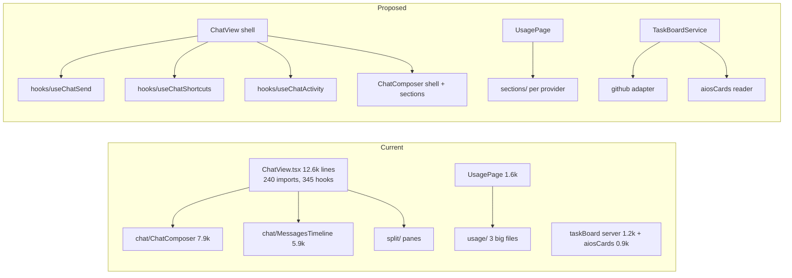

# Leonidas Code architecture audit (2026-10-12)

Scope: `src` of `apps/server`, `apps/web`, `apps/desktop`, `packages/shared`, `packages/client-runtime`, `packages/contracts` (2,321 non-test `.ts/.tsx` files). Measured by a line-count and import-pattern scan. **Not measured:** circular imports (no madge/dpdm installed; the repo disk was too slow to install and run one), dependency direction beyond the cross-app grep that timed out. Treat those as open.

## Scorecard

| Dimension | Grade | Evidence |
| --- | --- | --- |
| Module coupling | B | Only 37 server files and 3 other files use `../../../`; all server hits sit in `mcp/toolkits/*` |
| God modules | D | 270 files over 500 lines, 102 over 1,000, 25 over 2,700 |
| Directory semantics | B- | Server and packages are domain-shaped; `apps/web/src/components` is a flat dump (hundreds of files at the top level) |
| State isolation | B | Event-sourced orchestrator is pure; web stores are large but separated |
| Fork hygiene | B | Fork features live in own dirs (`taskBoard/`, `usage/`, `components/split/`); a few exceed 1,000 lines |

Most of the god-module count is inherited from upstream T3 Code, so refactoring it costs merge pain (`git merge upstream/main`). Prioritise fork-owned code and seams that do not touch upstream files.

## Current vs proposed

## Ranked targets (ROI = pain removed / merge risk)

| # | File | Issue | Fix | Upstream risk |
| --- | --- | --- | --- | --- |
| 1 | `apps/server/src/mcp/toolkits/*` (project, environment, attachment, device) | 3 to 7 `../../../` imports per file; leaked path knowledge | Add a `~/` or `#server/*` path alias (tsconfig `paths` + vite), codemod these ~8 files | Low |
| 2 | `apps/web/src/components/usage/UsagePage.tsx` (1,596) | Fork-owned page mixing layout, per-provider sections and formatting | Split into `sections/` per provider plus shared formatters | None (fork-only) |
| 3 | `apps/server/src/taskBoard/TaskBoardService.ts` (1,209), `aiosCards.ts` (859) | GitHub Issues sync, AIOS card parsing and polling in one service | Separate `GithubIssuesSource` and `AiosCardSource` behind one `TaskSource` interface; service only merges | None |
| 4 | `apps/server/src/usage/UsageService.ts` (1,041), `packages/shared/src/usageLimits.ts` (802), `usageMerge.ts` (646) | Calibration, quota merge and transcripts reading share one service | Extract calibration and transcript reader as their own services | None |
| 5 | `apps/web/src/components/ChatView.tsx` (12,598; 345 hook calls) | Upstream god component; every fork feature (split view, banners, failover) hooks into it, so each merge conflicts here | Do not rewrite. Move only fork hooks into `components/leonidas/*` and leave a one-line call in ChatView | Medium; only do the fork-owned extraction |
| 6 | `apps/web/src/components/` top level | Flat directory of hundreds of files | Group fork files under `components/leonidas/`; leave upstream files where they are | Low if upstream files stay put |
| 7 | `apps/server/src/mcp/OrchestratorMcpService.ts` (3,023), `ws.ts` (3,360) | Fork edits (task board, prompt suggestion) accumulate in shared handlers | Register fork RPCs and tools from a `leonidasRoutes.ts` module so `ws.ts` gets one line | Medium |

Upstream-owned giants (Orchestrator 11.7k, ClaudeAdapterV2 9.5k, CodexAdapterV2 7.4k, ProjectionStore 6.7k) are deliberately **not** targets.

## Phased plan (each phase ships green, no behaviour change)

- [ ] **Phase 0, measurement:** install `dpdm` in a scratch dir, run on `apps/server/src` and `apps/web/src`, record cycles here. Cheap, closes the biggest gap in this audit.
- [ ] **Phase 1, aliases:** add the path alias, codemod target 1 files, `vp run typecheck`.
- [ ] **Phase 2, fork-only splits:** targets 2, 3, 4, one PR each, existing focused tests must pass unchanged.
- [ ] **Phase 3, seams in upstream files:** targets 7 then 5 and 6 as single-line hook points; record in `LEONIDAS.md` status log so Mob's agent knows.
- [ ] **Guard:** add a lint rule or CI check that fork files stay under 800 lines and avoid `../../../`.

Each push to `main` ships to both machines, so run `vp run typecheck` and `vp test run <touched files>` per phase.
