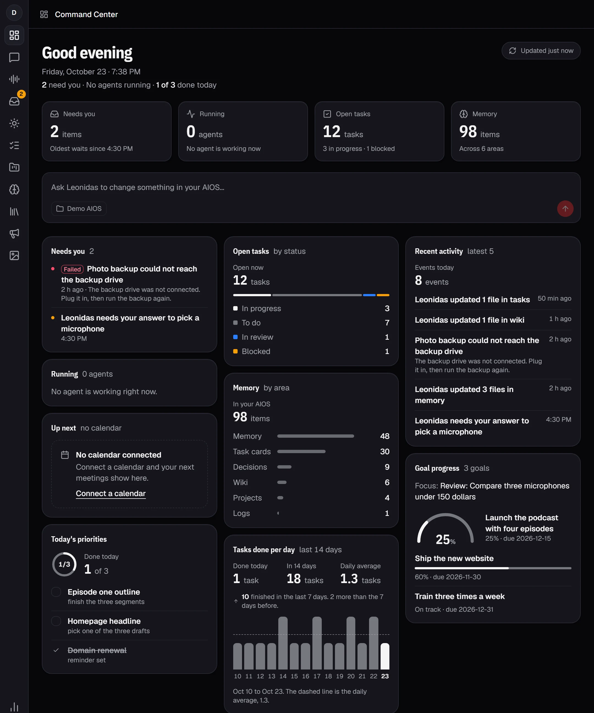
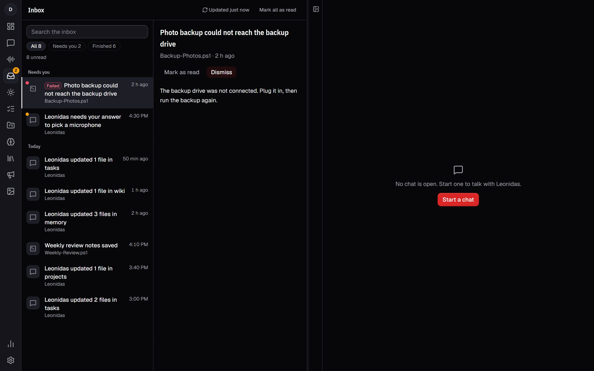

# See your whole AIOS on one screen

Leonidas has a new home. The Command Center shows what needs you, what is running and how your work is going, and a chat can stay open right beside it.

## Start every session from the Command Center

Four cards at the top give you the numbers first: items that need you, agents that are running, open tasks and memory items. Below them, cards show what needs your answer, recent activity, open tasks by status, today's priorities, goal progress and how many tasks you finished each day for the last two weeks.

Type in **Ask Leonidas** to start a chat about a change in your AIOS. **Updated just now** shows when the numbers were last read. Click it to read them again.

## Keep a chat open beside it

On a wide window, the screen splits in two: the Command Center or another view on the left, your chat on the right. Drag the divider to change the widths, and Leonidas keeps your choice. Press **Ctrl+Tab** to move between the two sides. On a narrow window, you see one side at a time.

The icon rail on the far left is now the only way to move around. It opens the Command Center, Chat, Scribe, the Inbox, Today, Tasks, Projects, Memory, the Library and more.

## Find everything that needs you in the Inbox

The **Inbox** collects questions from your agents and scripts that failed, with the newest first. Each item says what happened and what to do next, for example "Plug it in, then run the backup again". Use **Open chat** to answer, **Mark as read** to keep it, or **Dismiss** to clear it. The badge on the rail counts what still needs you.
