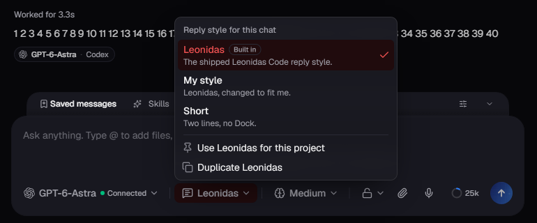
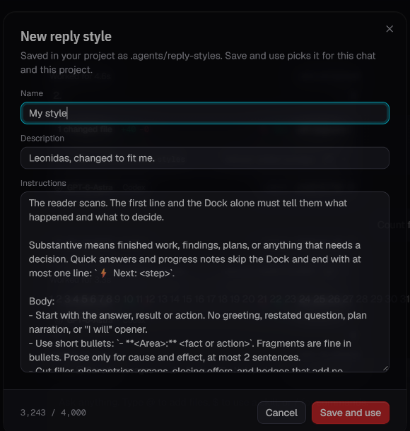

# Choose how the AI answers

You can now pick a reply style for each chat and each project. Leonidas stays the default. You can also make your own style from a copy of it.

## Switch the style in two clicks

A chip next to the model picker shows the reply style this chat uses. Click it, then pick a style. The next reply uses it. On a phone, the chip shows only its icon. The icon turns red when the chat uses a style other than Leonidas.

**Use for this project** in the same menu makes the style the default for every chat in the project. You can also set it in Settings, under New chats.

## Make your own style

Choose **Duplicate Leonidas**. An editor opens with the Leonidas instructions, a name and a short description. Change what you want, then choose **Save and use**. The style is saved in your project folder under `.agents/reply-styles`, and this chat and the project start to use it. Instructions can be up to 4,000 characters.

To change a style later, open the menu and choose **Edit**. To go back to the default, pick Leonidas.

## If a style cannot load

If a style file is missing or broken, replies use Leonidas. One notice says what is wrong, and an amber dot stays on the chip until you fix the file or pick another style.

Claude starts to use a new style in its next session. Codex uses it on the next reply.
