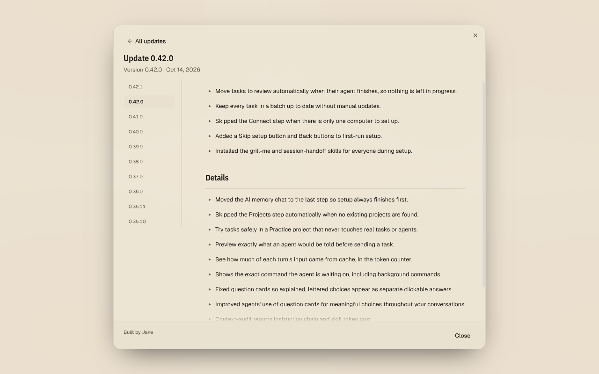

# Updates worth opening

Catch up with Leonidas Code through illustrated release stories. Browse the feed, open an update, and see the features, improvements, and fixes together.

## A home for every update

Update history now opens as a release feed. Each entry shows its version, date, and a short introduction. When a release includes a feature image, that image leads the story.

Open update history from the version number in the sidebar, the sidebar's history button, Settings, or the command palette.

## Browse first, then read

Choose **Read update** to open the complete article. On wider screens, a version library stays beside the article so you can switch releases without returning to the feed. On smaller screens, **All updates** takes you back to browsing.

Feature sections can include screenshots and captions, followed by the full patch notes. Older releases retain their original notes, even when they do not have pictures or an introduction.

## A calmer update notice

The update notice shows five highlights first. Expand the remaining changes or choose **Full notes** to read the story before installing. Installation actions stay together in the footer.

**Update when safe** waits for running agents to finish. **Restart now** keeps the existing confirmation when an agent is running. Reading a patch note never starts a chat or installs an update.

If the full article cannot load, the downloaded highlights remain available. You can retry or open update history later.
